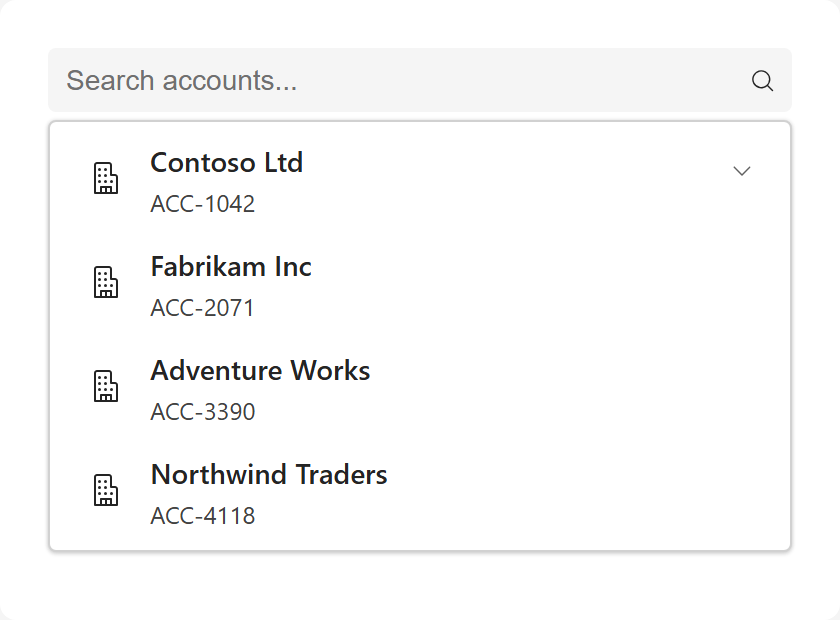
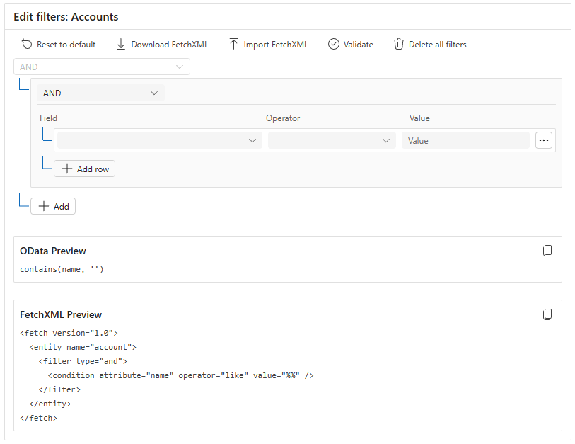
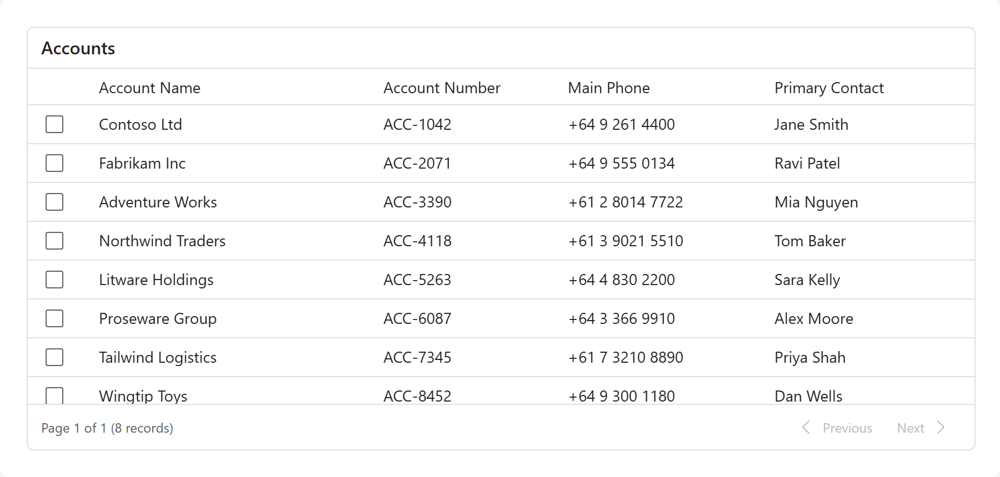
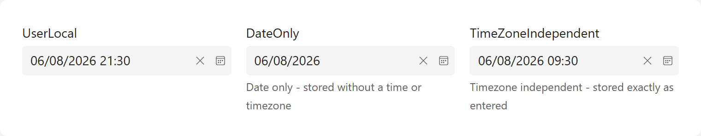
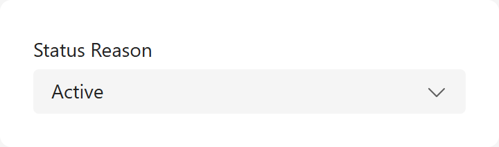
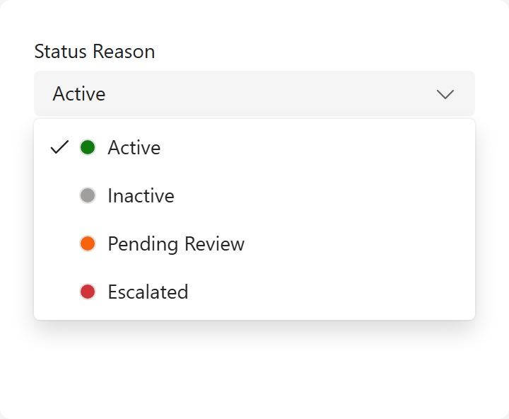
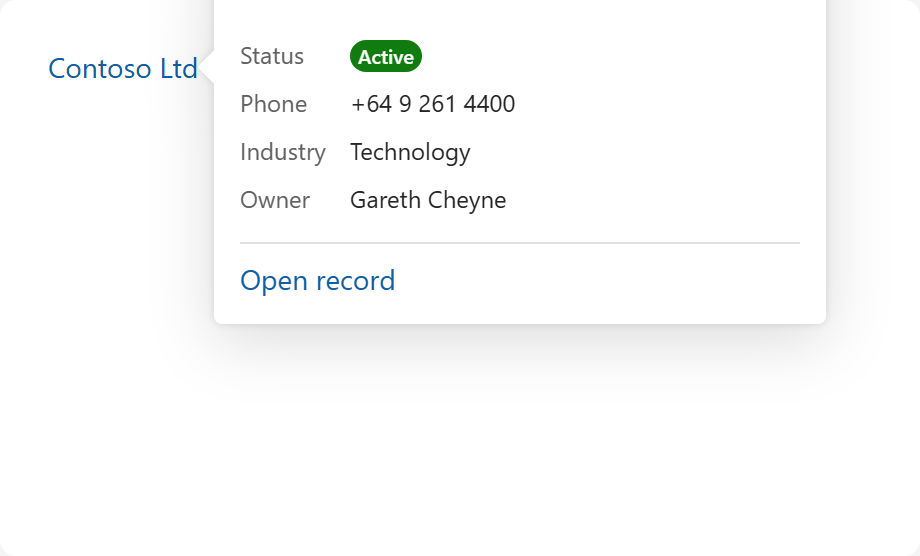
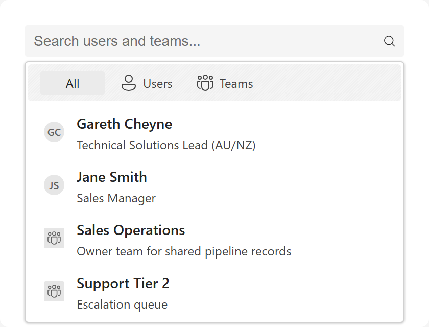
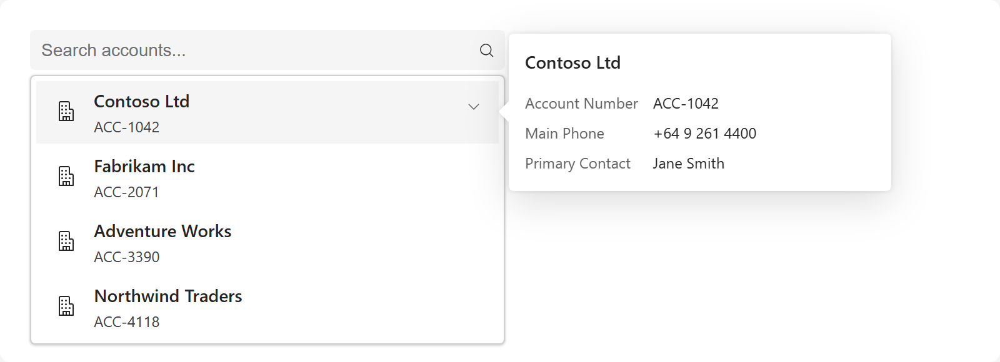

# FluentUI-Extended

Extended components for Fluent UI v9, designed to match Dynamics 365 patterns.

[](https://www.npmjs.com/package/fluentui-extended)
[](https://github.com/garethcheyne/npm-fluentui-extended/actions)

## Why This Library?

We started with the **Lookup** component because it's one of the most requested components in the Dynamics 365 and Power Platform community. Fluent UI v9 doesn't include a Lookup control out of the box, so we built one that matches the native Dynamics 365 experience.

**Have a component request?** Open an issue on [GitHub](https://github.com/garethcheyne/npm-fluentui-extended/issues) and we'll consider adding it!

This project is **open source** and **free to use**. It is provided as-is, without warranty. Community contributions are welcome—feel free to submit pull requests or suggest improvements!

## Installation

```bash
npm install fluentui-extended \
  @fluentui/react-components \
  @fluentui/react-icons \
  @fluentui/react-datepicker-compat \
  @fluentui/react-calendar-compat
```

## Appearance

Every field-like component in this library takes an `appearance` prop and **defaults it to
`filled-darker`**, which is how Dynamics 365 renders fields natively. Fluent's own default is
`outline`, which reads as foreign on a model-driven form — so the default is deliberately different
from upstream Fluent.

```tsx
<Lookup options={options} />                        // filled-darker
<Lookup options={options} appearance="outline" />   // opt back out
```

Applies to `Lookup`, `QueryBuilder` (every field inside it), `DateTimeField` and `OptionSetField`.
`CommandBar`, `EntityGrid` and `RecordHoverCard` are not field controls and take no `appearance`.

| Value | Notes |
|-------|-------|
| `outline` | Fluent's default |
| `underline` | Not supported by `Textarea`; falls back to `outline` there |
| `filled-darker` | **This library's default** — native Dynamics 365 |
| `filled-lighter` | |
| `filled-darker-shadow` | Deprecated upstream; narrowed to `filled-darker` on dropdowns |
| `filled-lighter-shadow` | Deprecated upstream; narrowed to `filled-lighter` on dropdowns |

The two shadow variants are deprecated in Fluent and will be removed there. They are accepted so
existing callers keep working, but `Combobox` and `Dropdown` never supported them, so a component
containing those narrows to the closest non-shadow fill rather than dropping the value.

### Fields inside a cell

On a form, a field draws its own box. Inside something that is itself the control — a grid cell, a
list row — that box sits inside the host's own focus ring and reads as a window within a window.
`Lookup`, `OptionSetField` and `DateTimeField` take `inline` for that case: the value alone, no fill,
border or underline in any state, with the chevron or the date buttons coming back on hover and
focus. The host draws the ring. `DataGrid` draws its own editors this way.

```tsx
<td className="my-cell">
  <OptionSetField inline size="small" options={options} value={value} onChange={setValue} />
</td>
```

## Using with AI coding agents

The package ships an agent skill in `skills/fluentui-extended/`: which component to reach for, how
to keep a page looking like native Dynamics 365 (a field on a form versus a value in a grid cell, dialogs
in a web resource, the shell around it), the Dataverse rules the components rely on, and a reference
for every component and Web API helper.

For Claude Code, copy it into your project's skills folder:

```bash
mkdir -p .claude/skills
cp -r node_modules/fluentui-extended/skills/fluentui-extended .claude/skills/
```

Other agents can be pointed at `node_modules/fluentui-extended/skills/fluentui-extended/SKILL.md`
directly; it is plain Markdown, with the detail in the `references/` folder beside it.

## New here? Run the harness

The fastest way to understand this library is to see every component working, in a simulated
Dynamics 365 form, with the code beside it:

```bash
git clone https://github.com/garethcheyne/npm-fluentui-extended.git
cd npm-fluentui-extended
pnpm install
pnpm run harness
```

That opens a mock model-driven app — top bar, sitemap, record form — with each component on its own
page: what it is for, when to reach for it, when to reach for something else, and a "Show code"
panel on every example holding the exact source that is running. The **Documentation** entry in the
sitemap gathers all of it in one page.

No Dynamics connection is needed; the examples run on mock data. To point them at a real org, see
[Local development](https://github.com/garethcheyne/npm-fluentui-extended/blob/main/docs/local-development.md).

## Components

### Lookup

A searchable dropdown component styled after Dynamics 365 lookup fields. Supports async search, expandable option details, and customizable header/footer.

**[Worked examples &rarr;](https://github.com/garethcheyne/npm-fluentui-extended/blob/main/docs/Lookup.md)** - async search, icons and details, header and footer, multi-entity lookups. Props are in the [API Reference](#api-reference).




### QueryBuilder

An Advanced Find-style query builder for Dynamics 365. Build complex filter conditions with AND/OR logic, serialize to FetchXML or OData, and validate queries against the Dynamics 365 API.

**[Read more &rarr;](https://github.com/garethcheyne/npm-fluentui-extended/blob/main/docs/QueryBuilder.md)** - usage, loading and reading FetchXML, queries OData cannot express, props and the programmatic API.



### CommandBar

A Dynamics-style command bar. Commands that no longer fit collapse into a "More commands" menu
rather than wrapping to a second row or being clipped.


### EntityGrid

> **🚧 Beta** — this is the only component in the library still marked as not yet stable.

A subgrid backed by the Web API: columns named from entity metadata, server-side paging and
sorting, and lookups rendered as names rather than GUIDs.



### DataGrid

A virtualised, editable grid on TanStack Table and TanStack Virtual, for the spreadsheet-style
screens a subgrid cannot carry: thousands of rows, inline editors, column drag and resize,
grouping with subtotals, and a column layout that survives a reload.

Bring your own rows — fetching and saving stay yours. The grid libraries are **optional** peer
dependencies, so nothing ships them unless you use this component.

```bash
npm install @tanstack/react-table @tanstack/react-virtual \
            @dnd-kit/core @dnd-kit/sortable @dnd-kit/utilities
```

```tsx
<DataGrid
  data={rows}
  columns={columns}
  getRowId={(row) => row.id}
  getCellValue={(row, key, rowId) => pending[rowId]?.[key] ?? row[key]}
  onCellChange={stageEdit}
  getRowState={(_, rowId) => (pending[rowId] ? 'dirty' : null)}
  selectable
  groupBy="category"
  persist={{ scope: 'quote-lines' }}
/>
```

**[Read more &rarr;](https://github.com/garethcheyne/npm-fluentui-extended/blob/main/docs/DataGrid.md)** - columns, unsaved-edit layering, persistence, and the headless `useDataGrid` hook.

### DateTimeField

A date/time field that respects the attribute's Dynamics `DateTimeBehavior`, so `DateOnly` values
cannot drift a day across timezones.



### OptionSetField

An optionset / multi-select picklist field that loads its options from metadata, including global
option sets, and round-trips multi-selects in the comma-separated form Dynamics stores.





### RecordHoverCard

A hover card for a record reference. The record is fetched lazily once the pointer settles, and the
result is held so re-opening costs nothing.



### SystemUserPersona

A Dynamics systemuser persona with the contact card a persona shows on a model-driven form.


### OwnerLookup

A preconfigured `Lookup` for `ownerid`. An owner is a user *or* a team, so both are searched;
selections render as the usual Lookup badges and multi-select comes for free.




### AddressLookup

A preconfigured `Lookup` for Google Places. Type an address, hover a suggestion to see it on a
map, and the selection arrives flattened into the columns an address is stored in.

Google bills per request, so the work is split the way the API prices it: typing buys
Autocomplete predictions only, and a place is resolved once - when its card opens, or when the
row is chosen, whichever happens first. The result is cached, so hovering then clicking the same
suggestion costs a single Place Details call.

Each suggestion is iconed by what it actually is - a street address, a building, a suburb, a
region, an airport, a shop - rather than every row carrying the same pin, so a list of mixed
results can be read at a glance.

```tsx
import { AddressLookup } from 'fluentui-extended';
import type { PlaceAddress } from 'fluentui-extended';

const [address, setAddress] = useState<PlaceAddress | null>(null);

<AddressLookup
  apiKey={googleMapsKey}
  label="Address"
  value={address}
  onSelect={(picked) => setAddress(picked)}
  countries={['nz', 'au']}
  stateShortName
  countryShortName
/>
```

`onSelect` receives the flattened address and the place it came from:

```ts
{
  placeId: 'ChIJ...',
  formattedAddress: '1 Queen Street, Auckland CBD, Auckland 1010, New Zealand',
  building: '', street: '1 Queen Street', suburb: 'Auckland CBD',
  city: 'Auckland', state: 'AUK', postcode: '1010', country: 'NZ',
  latitude: -36.8442, longitude: 174.7676,
}
```

The key needs the **Maps JavaScript API** and the **Places API** enabled, and the host's origin
allowed under its HTTP referrer restrictions. The Maps script is loaded once per page and shared,
so several AddressLookups on one form cost one script tag between them.

#### AddressLookup Props

| Prop | Type | Default | Description |
|------|------|---------|-------------|
| `apiKey` | `string` | - | Google Maps API key (required) |
| `value` / `onSelect` | `PlaceAddress \| null` | - | Selection (controlled). `onSelect` also receives the full `PlaceDetail` |
| `countries` | `string \| string[]` | - | Restrict to ISO country codes, e.g. `['nz','au']`. Google allows five |
| `searchTypes` | `string[]` | `['address']` | Use `['establishment']` for businesses, `['geocode']` for anything mappable |
| `stateShortName` | `boolean` | `false` | Return `NSW` rather than `New South Wales` |
| `countryShortName` | `boolean` | `false` | Return `AU` rather than `Australia` |
| `showMapCard` | `boolean` | `true` | Map card on hover |
| `mapCardTarget` | `'list' \| 'rest' \| 'both'` | `'both'` | Where the card is offered |
| `mapCardDelayMs` | `number` | `400` | Pointer settle delay before the place is resolved |
| `mapZoom` | `number` | `15` | Map zoom on the card |
| `showCoordinates` / `showRatings` | `boolean` | `true` | Card detail toggles |
| `cardActions` | `ReactNode` | - | Content at the bottom of the card |
| `minSearchLength` | `number` | `3` | Short input never leaves the browser |
| `onError` | `(error) => void` | - | Search or place lookup failures |

The Places client is exported on its own for geocoding outside a form:
`loadGoogleMaps`, `searchPlacePredictions`, `getPlaceDetails`, `parsePlaceAddress`,
`placeMapUrl`, `isGoogleMapsReady`, `clearPlacesCache`.

### ParentPortal

Renders Fluent UI content in the **parent document**, escaping an iframe boundary with full styling. Designed for Dynamics 365 web resources where dialogs must float above the entire D365 page rather than being trapped inside the iframe.

**Problem:** Fluent UI v9 has no built-in cross-frame portal. `mountNode` targets a DOM node but Griffel injects styles into the iframe's `<head>`. D365's auto-height mechanism detects `scrollHeight` changes and adds scrollbars.

**Solution:** `ParentPortal` creates a container in `window.parent.document`, syncs all Griffel CSSOM rules to the parent, and copies Fluent theme tokens — so components render fully styled in the parent page.

A `DialogSurface` portals itself, so it takes the parent document's mount node from
`useParentPortalMount()` rather than being wrapped. `<ParentPortal>` is for content that does not
portal on its own.

```tsx
import { Dialog, DialogSurface, DialogBody, DialogTitle, DialogContent } from '@fluentui/react-components';
import { ParentPortal, useParentPortalMount } from 'fluentui-extended';

function MyDialog({ open, onClose }: { open: boolean; onClose: () => void }) {
  const mountNode = useParentPortalMount();
  return (
    <Dialog open={open} onOpenChange={(_, d) => !d.open && onClose()}>
      <DialogSurface mountNode={mountNode}>
        <DialogBody>
          <DialogTitle>Escaped the iframe</DialogTitle>
          <DialogContent>
            This dialog renders in the parent D365 document with full
            Fluent styling — no scrollbars, no forced iframe resize.
          </DialogContent>
        </DialogBody>
      </DialogSurface>
    </Dialog>
  );
}

function Banner() {
  return (
    <ParentPortal>
      <div>Rendered in the parent document</div>
    </ParentPortal>
  );
}
```

| Prop | Type | Default | Description |
|------|------|---------|-------------|
| `children` | `ReactNode` | — | Content to render in the parent document |
| `containerId` | `string` | `'fluentui-extended-parent-portal-root'` | ID for the container element in the parent |
| `syncStyles` | `boolean` | `true` | Sync Griffel stylesheets to the parent |
| `syncTokens` | `boolean` | `true` | Copy Fluent CSS custom properties (theme tokens) |
| `syncInterval` | `number` | `300` | Interval (ms) for CSSOM rule re-sync |
| `containerStyles` | `string` | *(built-in)* | Custom CSS for the parent container |

**How it works:**
1. Creates a `position: fixed` container in `window.parent.document.body`
2. Uses `React.createPortal` to render a `FluentProvider` + children into that container
3. Serializes all `CSSStyleSheet.cssRules` from iframe `<style>` elements (Griffel uses `insertRule()`, so `textContent` is empty) and mirrors them to the parent `<head>`
4. Copies CSS custom properties (`--colorNeutralBackground1`, etc.) from the iframe's `FluentProvider` to the parent container
5. A `MutationObserver` + interval catches lazily-inserted Griffel rules
6. Falls back to in-place rendering if not inside an iframe

> **Requires same-origin:** The iframe and parent must be on the same domain (standard for D365 web resources).

### FluentShell

The outermost element of a Dynamics 365 web resource, fitting the app to whatever chrome hosts its iframe. The right gutter is not a constant - it depends on what the host already pads and where the form's content column sits, both of which move with the window and the D365 release - so `FluentShell` measures both and adds only the difference.

```tsx
import { FluentProvider, webLightTheme } from '@fluentui/react-components';
import { FluentShell } from 'fluentui-extended';

function Root() {
  return (
    <FluentProvider theme={webLightTheme} style={{ height: '100%' }}>
      <FluentShell>
        <div>app</div>
      </FluentShell>
    </FluentProvider>
  );
}
```

Nothing below it should set an outer margin - the two compound invisibly.
**[Read more &rarr;](https://github.com/garethcheyne/npm-fluentui-extended/blob/main/docs/FluentShell.md)** - props, surface detection, and the console tooling for a deployed web resource.

### FluentContainer

A card matching the surface D365 draws on a model-driven form, measured from a live form: `shadow4`, an 8px radius, and a **transparent** hairline border on the neutral page ground.

```tsx
import { FluentContainer } from 'fluentui-extended';

function Cards() {
  return (
    <FluentContainer fill scrolls="vertical" padding="none">
      <div>grid</div>
    </FluentContainer>
  );
}
```

**[Read more &rarr;](https://github.com/garethcheyne/npm-fluentui-extended/blob/main/docs/FluentContainer.md)** - props, and why clipping is opt-in.

### D365TestHarness

A local stand-in for the D365 form that will host a web resource. On a bare dev server there is no chrome to measure, so `FluentShell` falls back to standalone behaviour and the layout you develop is not the one that ships. The harness hosts your app in a genuine same-origin iframe and reproduces the geometry a live form measures, so the same gutters resolve locally as in the org.

```tsx
import { D365TestHarness, FluentShell } from 'fluentui-extended';

function Root() {
  return (
    <D365TestHarness recordName="Boomer iMAC" entityName="Price List">
      <FluentShell>
        <div>app</div>
      </FluentShell>
    </D365TestHarness>
  );
}
```

It is inactive outside a local host, so the same tree ships to Dynamics unwrapped.
**[Read more &rarr;](https://github.com/garethcheyne/npm-fluentui-extended/blob/main/docs/D365TestHarness.md)**
Setting this up in your own project also needs a dev-server proxy to reach Dataverse from `localhost`: see **[Local development](https://github.com/garethcheyne/npm-fluentui-extended/blob/main/docs/local-development.md)**.

## Quick Start

```tsx
import { useState } from 'react';
import { Lookup, LookupOption } from 'fluentui-extended';
import { FluentProvider, webLightTheme } from '@fluentui/react-components';

const options: LookupOption[] = [
  { key: '1', text: 'Contoso Ltd', secondaryText: 'CON001' },
  { key: '2', text: 'Fabrikam Inc', secondaryText: 'FAB001' },
  { key: '3', text: 'Adventure Works', secondaryText: 'ADV001' },
];

function App() {
  const [selected, setSelected] = useState<LookupOption | null>(null);

  return (
    <FluentProvider theme={webLightTheme}>
      <Lookup
        options={options}
        selectedOption={selected}
        onOptionSelect={setSelected}
        placeholder="Search accounts..."
      />
    </FluentProvider>
  );
}
```

## Test Harness Examples

Run the test harness with `pnpm run harness` to see all examples in action. The harness is split into
one tab per component, so each can be viewed and screenshotted on its own.

| Example | Tab | Description |
|---------|-----|-------------|
| **Basic Lookup** | Lookup | Simple lookup with expandable details, no header/footer |
| **Header & Footer** | Lookup | D365-style with "Accounts" header and "New" / "Advanced" footer links |
| **Details Only (No Secondary Text)** | Lookup | Options with icons + details but no secondary text; demonstrates icon centering on single-line text |
| **Multi-Entity Filter** | Lookup | Toggle between Accounts/Contacts with drill-down header pattern (← All) |
| **Dynamic Search (Async API)** | Lookup | Simulated 800ms API delay with loading spinner; auto-loads top 5 on open |
| **Live Dynamics Lookup** | Lookup | Connects to real D365 environment via Xrm.WebApi (when connected) |
| **QueryBuilder** | Query Builder | Full Advanced Find-style query builder with FetchXML serialization |
| **Unknown / Invalid Fields** | Query Builder | FetchXML referencing attributes that match no known field, each flagged inline |
| **Command Bar** | Command Bar | Nine commands collapsing into an overflow menu; narrow the window to watch them move |
| **Pinned / no overflow** | Command Bar | A pinned command that never collapses, and horizontal scrolling with overflow disabled |
| **Entity Grid** | Entity Grid | Server-paged accounts with sorting, selection and formatted lookup values (needs a connection) |
| **DateTimeBehavior** | Fields | One picked date serialized three ways, showing which behaviours pass through UTC |
| **OptionSetField** | Fields | Single-select with metadata colours, and a multi-select round-tripping as "1,2" |
| **Record Hover Card** | Hover Card | Static and live record cards with lazy loading on hover intent |

## API Reference

### Resolved Lookup (rest state)

Once a record is selected and the dropdown is closed, the field renders the way a resolved lookup
does on a Dynamics form: the table's icon (or its entity image), the record name as a link, a clear
button, and a magnifier rather than a chevron.

```tsx
<Lookup
  options={options}
  selectedOption={selected}
  onOptionSelect={setSelected}
  entityIcon={<BuildingRegular />}                      // falls back to the option's own icon
  entityImage={account.entityimage_url}                 // wins over the icon when the table has one
  onRecordClick={(option) => openRecord(option.key)}    // clicking the name opens the record
/>
```

If the selected option carries Dynamics record metadata (`entityName` plus `recordId` or `key`), the
Lookup now behaves like a native Dynamics field by default:

- Clicking the resolved value opens the record
- `Xrm.Navigation.openForm(...)` is used when available
- Outside a form, it falls back to a Dynamics `main.aspx` entity-record URL

Pass `onRecordClick` to override that default navigation. Set `recordLinkAppearance={false}` to render
the value as plain input text instead.

### Lookup Setup Modes

The same component supports three distinct setups:

#### 1. Plain custom values

Use this when the lookup is just a searchable picker and does not represent a Dynamics table row.

```tsx
const options: LookupOption[] = [
  { key: 'draft', text: 'Draft' },
  { key: 'submitted', text: 'Submitted' },
  { key: 'approved', text: 'Approved' },
];

<Lookup
  options={options}
  selectedOption={selected}
  onOptionSelect={setSelected}
/>
```

Only `key` and `text` are required. In this mode there is no record navigation and no Web API-backed
hover card unless you provide your own custom card body.

#### 2. Dynamics-backed records

Use this when each option represents a real Dataverse / Dynamics record.

```tsx
const options: LookupOption[] = [
  {
    key: '00000000-0000-0000-0000-000000000001',
    text: 'Contoso Ltd',
    entityName: 'account',
    recordId: '00000000-0000-0000-0000-000000000001',
  },
];

<Lookup
  options={options}
  selectedOption={selected}
  onOptionSelect={setSelected}
/>
```

When `entityName` and `recordId` are present, the selected value can behave like a native Dynamics
lookup link and the built-in record hover card can fetch the record lazily.

#### 3. Dynamics-backed records with hover cards

Turn on `showHoverCard` when you want the lookup to reveal record details on hover.

```tsx
<Lookup
  options={options}
  selectedOption={selected}
  onOptionSelect={setSelected}
  showHoverCard
  hoverCardColumns={['accountnumber', 'telephone1', 'primarycontactid']}
  hoverCardTarget="both"
/>
```

Two hover-card modes are supported:

- Built-in record card: provide `entityName` and `recordId` on each option, plus `hoverCardColumns`
- Custom card body: provide `renderHoverCard={(option) => ...}`

If a rest-state hover card is active, the component does not also show the compacted-value tooltip on
that same surface.

### Lookup Props

| Prop | Type | Default | Description |
|------|------|---------|-------------|
| `id` | `string` | auto-generated | Unique identifier for the lookup |
| `appearance` | `FieldAppearance` | `'filled-darker'` | See [Appearance](#appearance) |
| `entityIcon` | `React.ReactNode` | option's `icon` | Table icon shown at rest |
| `entityImage` | `string` | - | Entity image URL, shown in place of the icon |
| `recordLinkAppearance` | `boolean` | `true` | Render the resolved value as a link |
| `onRecordClick` | `(option: LookupOption) => void` | - | Overrides the default Dynamics record navigation when the resolved value is clicked |
| `options` | `LookupOption[]` | `[]` | Options to display in the dropdown |
| `selectedKey` | `string \| null` | - | Selected option key (controlled) |
| `selectedOption` | `LookupOption \| null` | - | Selected option object (recommended for async) |
| `onOptionSelect` | `(option: LookupOption \| null) => void` | - | Selection change callback |
| `onSearchChange` | `(searchText: string) => void` | - | Search text change callback |
| `placeholder` | `string` | `'Search...'` | Input placeholder |
| `loading` | `boolean` | `false` | Show loading spinner |
| `noResultsMessage` | `string` | `'No results found'` | Empty state message |
| `clearable` | `boolean` | `true` | Show clear button |
| `inline` | `boolean` | `false` | Draw as the value with no field box, for a host that draws the focus ring (a grid cell, a list row). See [Fields inside a cell](#fields-inside-a-cell) |
| `minSearchLength` | `number` | `0` | Min chars before search fires |
| `searchDebounceMs` | `number` | `300` | Search debounce delay (ms) |
| `matchInputWidth` | `boolean` | `true` | Match dropdown width to input width |
| `header` | `ReactNode` | - | Header content |
| `footer` | `ReactNode` | - | Footer content |
| `disabled` | `boolean` | `false` | Disable the lookup |
| `open` | `boolean` | - | Controlled open state for the dropdown |
| `onOpenChange` | `(open: boolean) => void` | - | Callback when dropdown open state changes |
| `disableClientFilter` | `boolean` | `false` | Disable client-side filtering of options. Use this when filtering is performed server-side via `onSearchChange` |
| `showHoverCard` | `boolean` | `false` | Reveal a hover card on lookup rows and/or the resolved value |
| `hoverCardColumns` | `string[]` | - | Columns fetched and listed by the built-in record card |
| `renderHoverCard` | `(option: LookupOption) => ReactNode` | - | Build the hover card body yourself |
| `hoverCardTarget` | `'list' \| 'rest' \| 'both'` | `'both'` | Which lookup surfaces offer the hover card |
| `hoverCardDelayMs` | `number` | `400` | Hover-intent delay before opening the card |
| `hoverCardActions` | `ReactNode` | - | Footer actions rendered on the card |
| `searchFields` | `string` | - | Hidden searchable text (never rendered). Use this to include additional searchable content (codes, IDs) while displaying JSX in `secondaryText` |
| `hierarchical` | `boolean` | `false` | Show options as a tree from each option's `parentKey`. See [Hierarchical Lookup](#hierarchical-lookup) |
| `defaultExpanded` | `'all' \| 'none' \| number` | `'all'` | Levels open to start with; `1` opens the top level only |
| `onLoadChildren` | `(option) => Promise<LookupOption[] \| void>` | - | Load a node's children the first time it opens (options with `hasChildren`) |
| `selectableParents` | `boolean` | `true` | Off, a parent only opens and closes; only the bottom level can be chosen |
| `showPath` | `boolean` | `false` | Show the chosen value with its ancestors, e.g. `Electrical › Lighting` |
| `pathSeparator` | `string` | `' › '` | Separator between the levels of `showPath` |

### Client-Side Filtering

By default, the Lookup component filters options client-side as the user types. The filtering logic works as follows:

1. **Primary field (`text`)** — Always searched, regardless of other props
2. **Search fields (`searchFields`)** — If provided, this hidden text is searched (useful when `secondaryText` is JSX)
3. **Secondary text (`secondaryText`)** — Only searched if it's a string (JSX elements are skipped)

This allows you to use rich JSX (badges, icons) in `secondaryText` while still providing searchable text via `searchFields`:

```tsx
const options: LookupOption[] = [
  {
    key: 'PROD-001',
    text: 'Acme Widget',                           // Always searchable
    searchFields: 'PROD-001 SKU-12345 acme-widget', // Hidden searchable text
    secondaryText: (                               // Rich display (not searchable)
      <span style={{ display: 'flex', gap: 4 }}>
        <Badge size="small">PROD-001</Badge>
        <Badge size="small" color="brand">SKU-12345</Badge>
      </span>
    ),
  },
];
```

**Server-Side Filtering:** When using `onSearchChange` to fetch results from an API, set `disableClientFilter={true}` to prevent the client from re-filtering server results:

```tsx
<Lookup
  options={apiResults}
  onSearchChange={(searchText) => fetchFromApi(searchText)}
  disableClientFilter={true}  // API already filtered the results
  loading={isLoading}
/>
```

### Cross-Document Support (Dynamics 365 Iframes)

The Lookup component automatically detects when it's rendered inside a cross-document context (e.g., a React tree mounted into a parent window's document from an iframe). It uses `ownerDocument` and `ownerDocument.defaultView` instead of the global `document` and `window` to ensure:

- **Dismiss on click outside** works correctly (mousedown listener on the correct document)
- **Scroll/resize tracking** responds to the correct window's events
- **Dropdown positioning** uses the correct scroll offsets

### Inherited Input Props

The Lookup component extends Fluent UI's `Input` and supports these standard props:

| Prop | Type | Default | Description |
|------|------|---------|-------------|
| `appearance` | `'outline' \| 'underline' \| 'filled-darker' \| 'filled-lighter'` | `'filled-darker'` | Visual style of the input. See [Appearance](#appearance) |
| `size` | `'small' \| 'medium'` | `'medium'` | `small` is 24px, for dense layouts |
| `contentBefore` | `ReactNode` | - | Content before the input text |
| `className` | `string` | - | Additional CSS class |
| `style` | `CSSProperties` | - | Inline styles |

```tsx
// Examples
<Lookup appearance="outline" size="medium" ... />
<Lookup appearance="underline" size="small" ... />
```

### LookupOption

```ts
interface LookupOption {
  key: string;                      // Unique identifier (required)
  text: string;                     // Display text (required)
  secondaryText?: ReactNode;        // Secondary line - string, Badge, or JSX
  searchFields?: string;            // Hidden searchable text (never rendered)
  icon?: ReactNode;                 // Icon component (e.g., <BuildingRegular />)
  details?: LookupOptionDetail[];   // Expandable details (chevron appears)
  data?: unknown;                   // Custom data payload for your app
  disabled?: boolean;               // Disable this option
  entityName?: string;              // Dynamics table logical name, e.g. 'account'
  recordId?: string;                // Dynamics record GUID; falls back to key when omitted
  parentKey?: string | null;        // Parent option's key, for a hierarchical Lookup
  hasChildren?: boolean;            // Has children not loaded yet (draws the chevron)
}

interface LookupOptionDetail {
  label?: ReactNode;  // Optional label (e.g., "Phone:" or a Badge)
  value: ReactNode;   // Detail value - string or JSX element
}
```

> **Note:** Both `secondaryText` and `details` support React elements, not just strings. See [Rich Secondary Text](https://github.com/garethcheyne/npm-fluentui-extended/blob/main/docs/Lookup.md#rich-secondary-text-with-react-elements) for examples. When using JSX in `secondaryText`, use `searchFields` to provide hidden searchable text (see [Client-Side Filtering](#client-side-filtering)).

`entityName` plus `recordId` are what switch a generic option into a Dynamics-backed record option.
That metadata is used by the default selected-value navigation path and by the built-in hover-card
fetch path.

### Hierarchical Lookup

Set `hierarchical` and give each option the key of its parent. The level is worked out from the
chain of parents, so it is not passed — a level supplied alongside a parent can only disagree with it.
An option whose parent is not among the options shows at the top level.

```tsx
const categories: LookupOption[] = [
  { key: 'elec', text: 'Electrical' },
  { key: 'light', text: 'Lighting', parentKey: 'elec' },
  { key: 'led', text: 'LED downlights', parentKey: 'light' },
];

<Lookup
  options={categories}
  hierarchical
  defaultExpanded={1}        // top level open
  selectableParents={false}  // only the bottom level is a real value
  showPath                   // "Electrical › Lighting › LED downlights"
  selectedOption={selected}
  onOptionSelect={setSelected}
/>
```

Typing narrows the tree to the matches and their ancestors, opened up and with the ancestors dimmed,
so each match is seen in its place. The popup is an ARIA `tree`, each row a `treeitem` carrying its
`aria-level`.

**Dataverse hierarchies.** A table can mark one relationship to itself as hierarchical — account →
parent account, business unit → parent business unit, product families, and custom tables.
`useHierarchyLookup` reads that relationship from metadata, so nothing but the table name is passed:

```tsx
import { useHierarchyLookup } from 'fluentui-extended';

function ParentAccountField() {
  const [value, setValue] = useState<LookupOption | null>(null);
  const hierarchy = useHierarchyLookup('account', { filter: 'statecode eq 0' });
  return <Lookup {...hierarchy} selectedOption={value} onOptionSelect={setValue} showPath />;
}
```

It starts from the top of the tree, loads children as nodes are opened, and searches server-side,
returning each match with its ancestors (one request per level, not per match). Which records have
children is one FetchXML aggregate per page. The functions underneath — `getHierarchyRelationship`,
`getHierarchyChildren` and `searchHierarchy` — are exported for use without the hook.

## Keyboard Navigation

| Key | Action |
|-----|--------|
| `↓` | Open dropdown / Move to next option |
| `↑` | Move to previous option |
| `→` | Hierarchical: open the highlighted node, or move to its first child |
| `←` | Hierarchical: close the highlighted node, or move to its parent |
| `Enter` | Select highlighted option (opens / closes a parent when `selectableParents` is off) |
| `Escape` | Close dropdown |
| `Tab` | Close dropdown and move focus |

---

## CommandBar

Fluent ships `Toolbar` and `Overflow` as separate primitives. `CommandBar` composes them into the
behaviour a command bar needs: commands that no longer fit move into a "More commands" menu instead
of wrapping or being clipped. Widths are measured from the live DOM, so label length and icons are
accounted for rather than estimated.

```tsx
import { CommandBar } from 'fluentui-extended';
import { AddRegular, EditRegular, DeleteRegular } from '@fluentui/react-icons';

<CommandBar
  items={[
    { key: 'new', text: 'New', icon: <AddRegular />, appearance: 'primary', onClick: handleNew },
    { key: 'edit', text: 'Edit', icon: <EditRegular />, onClick: handleEdit },
    { key: 'delete', text: 'Delete', icon: <DeleteRegular />, dividerBefore: true, onClick: handleDelete },
    {
      key: 'export',
      text: 'Export',
      subItems: [{ key: 'excel', text: 'Export to Excel', onClick: handleExport }],
    },
  ]}
/>
```

### CommandBar Props

| Prop | Type | Default | Description |
|------|------|---------|-------------|
| `items` | `CommandBarItem[]` | - | Commands rendered from the left (required) |
| `farItems` | `CommandBarItem[]` | - | Right-aligned commands; never collapse |
| `size` | `'small' \| 'medium' \| 'large'` | `'small'` | Button size |
| `disableOverflow` | `boolean` | `false` | Scroll horizontally instead of collapsing |
| `overflowAriaLabel` | `string` | `'More commands'` | Label for the overflow trigger |

`CommandBarItem` carries `key`, `text`, `icon`, `onClick`, `disabled`, `appearance`, `checked` (renders
a toggle), `subItems` (renders a menu button, preserved as a submenu when overflowed), `dividerBefore`,
and `pinned`. A pinned command never collapses — use it sparingly, because one that does not fit is
clipped rather than moved.

### Tooltips

Commands take Fluent tooltips in three forms, and they show on hover and focus whether or not the
command has a visible label.

| Prop | Type | Description |
|------|------|-------------|
| `title` | `string` | Tooltip heading. Also the accessible name for icon-only commands |
| `description` | `React.ReactNode` | Body text under the title. Its presence makes the tooltip rich |
| `tooltip` | `React.ReactElement` | Fully custom content; overrides `title`/`description` as the body |

```tsx
<CommandBar
  items={[
    // Plain — a single line of text
    { key: 'edit', text: 'Edit', title: 'Edit the selected record' },

    // Rich — semibold heading over a body line
    {
      key: 'new',
      text: 'New',
      title: 'New record',
      description: 'Opens a blank form for this table.',
    },

    // description takes markup, so it can carry its own emphasis
    {
      key: 'delete',
      text: 'Delete',
      title: 'Delete',
      description: <>Permanently removes it. <strong>This cannot be undone.</strong></>,
    },

    // Fully custom content
    {
      key: 'flow',
      text: 'Flow',
      title: 'Flow',
      tooltip: (
        <span>
          <strong>Power Automate</strong>
          <br />Run or manage flows for this record.
        </span>
      ),
    },
  ]}
/>
```

**Accessibility.** The tooltip's `relationship` is chosen for you from whether the command has a
visible label. An icon-only command with a plain `title` uses `relationship="label"`, so the tooltip
becomes its accessible name. A command with visible text uses `relationship="description"`, leaving
the label as the name — otherwise a screen reader would announce the explanation instead of the
command. When a rich or custom tooltip is used on an icon-only command, `title` still supplies a
short accessible name rather than the whole tooltip body being read out, so it is worth setting
alongside `tooltip`.

Inside the overflow menu, only `description` and `tooltip` produce a tooltip. A `title`-only one is
suppressed there, since the menu row already displays that exact text.

---

## EntityGrid

> **🚧 Beta.** EntityGrid is the only component still marked as not yet stable.

A subgrid backed by the Web API. `DataGrid` renders rows you already have; `EntityGrid` fetches them.

Paging uses `Prefer: odata.maxpagesize` and follows `@odata.nextLink`, rather than `$top`/`$skip` —
Dynamics does not support `$skip` for arbitrary offsets, and `$top` suppresses the paging cookie
entirely. Because `nextLink` only moves forward, the URL of each visited page is kept so Previous can
replay it.

```tsx
import { EntityGrid } from 'fluentui-extended';

<EntityGrid
  entityName="account"
  title="Accounts"
  height={420}
  pageSize={25}
  selectable
  columns={[
    { name: 'name', width: 260 },
    { name: 'accountnumber' },
    { name: 'primarycontactid', label: 'Primary Contact' },
  ]}
  onRecordOpen={(id) => Xrm.Navigation.openForm({ entityName: 'account', entityId: id })}
/>
```

Cells prefer the `@OData.Community.Display.V1.FormattedValue` annotation Dynamics attaches, which is
what renders a lookup as a name and an optionset as its label rather than a GUID or an integer. The
grid requests those annotations for you.

### EntityGrid Props

| Prop | Type | Default | Description |
|------|------|---------|-------------|
| `entityName` | `string` | - | Entity logical name (required) |
| `columns` | `EntityGridColumn[]` | primary name attribute | Columns to render |
| `filter` | `string` | - | OData filter applied to every page |
| `defaultSort` | `EntityGridSort` | primary name ascending | Initial sort |
| `pageSize` | `number` | `25` | Rows per page |
| `selectable` | `boolean` | `false` | Show selection checkboxes |
| `onRecordOpen` | `(id, record) => void` | - | Row activation handler |
| `onSelectionChange` | `(ids: string[]) => void` | - | Selection handler |
| `height` | `number \| string` | - | Fixed height for the scrolling body |

`EntityGridColumn` carries `name`, `label` (defaults to the metadata display name), `width`,
`sortable`, and `render(formatted, record)` for custom cells.

Pair it with QueryBuilder by passing that component's `odataFilter` output as `filter`.

---

## DateTimeField

Dynamics has three `DateTimeBehavior` values and they do not agree on what a stored string means, so
a single `new Date(value)` is wrong for two of the three:

| Behavior | Stored as | Conversion |
|----------|-----------|------------|
| `UserLocal` | UTC | Converted to the user's timezone |
| `DateOnly` | Calendar date, no time or zone | None — must never shift |
| `TimeZoneIndependent` | Wall-clock, no zone | None — shown exactly as entered |

The trap is that `new Date('2026-08-06')` parses as UTC midnight, which renders as the 5th anywhere
west of Greenwich, while `toISOString()` on a local date shifts the day for any user east of it.
`DateTimeField` handles both explicitly.

```tsx
import { useState } from 'react';
import { DateTimeField, DateTimeRangeField } from 'fluentui-extended';

function Example() {
  const [value, setValue] = useState<string | null>(null);
  const [range, setRange] = useState({
    startValue: null as string | null,
    endValue: null as string | null,
  });

  return (
    <>
      <DateTimeField
        label="Estimated Close Date"
        behavior="DateOnly"
        value={value}
        onChange={(stored) => setValue(stored)}  // "2026-08-06", never an ISO timestamp
      />

      <DateTimeRangeField
        label="Booking window"
        showTime
        value={{ start: range.startValue, end: range.endValue }}
        onChange={({ startValue, endValue, startDate, endDate }) => {
          setRange({ startValue, endValue });
          console.log(startDate, endDate);
        }}
      />
    </>
  );
}
```

Pass `entityName` and `attributeName` to read the behavior from metadata instead of declaring it.
The conversion helpers are exported for use outside the component:

```ts
import { parseStoredValue, formatStoredValue } from 'fluentui-extended';

const date = parseStoredValue('2026-08-06', 'DateOnly');   // local midnight on the 6th
const stored = formatStoredValue(date, 'DateOnly');        // "2026-08-06"
```

`DateTimeRangeField` is a composed helper for "between" inputs. It renders a start and end
`DateTimeField` side by side and emits both the serialized values (`startValue`, `endValue`) and the
resolved `Date` objects (`startDate`, `endDate`) in one callback.

### DateTimeField Props

| Prop | Type | Default | Description |
|------|------|---------|-------------|
| `value` | `string \| Date \| null` | - | Stored value, interpreted per `behavior` |
| `onChange` | `(value: string \| null, date: Date \| null) => void` | - | Serialized value plus the Date |
| `behavior` | `DateTimeBehavior` | `'UserLocal'` | How the attribute is stored |
| `showTime` | `boolean` | `false` | Show a time picker; ignored for `DateOnly` |
| `timeIntervalMinutes` | `number` | `30` | Spacing of the time dropdown entries |
| `entityName` / `attributeName` | `string` | - | Read `behavior` from metadata |
| `clearable` | `boolean` | `true` | Show a clear button |
| `inline` | `boolean` | `false` | Value only, no field box; the buttons show on hover and focus. See [Fields inside a cell](#fields-inside-a-cell) |

---

## OptionSetField

```tsx
import { OptionSetField } from 'fluentui-extended';

// Options loaded from metadata
<OptionSetField entityName="account" attributeName="industrycode" value={value} onChange={setValue} />

// Multi-select picklist
<OptionSetField
  options={options}
  multiselect
  value={values}              // accepts [1, 2] or the stored "1,2"
  onChange={(next) => setValues(next as number[])}
/>
```

Two Dynamics details this handles that a plain `Dropdown` does not. A **global option set** leaves
`OptionSet` empty and puts its values on `GlobalOptionSet` instead — reading only the former is why a
dropdown that should be populated comes back empty. And a **multi-select picklist** stores its value
as a comma-separated string, so `"1,2"` and `[1, 2]` have to mean the same thing; `parseSelectedValues`
and `formatMultiSelectValue` are exported for that conversion.

When an option set has many values, the popup list stays constrained and scrolls inside the listbox
instead of growing indefinitely. The control also supports typing to filter options by label, which
is especially useful for long status-reason, industry, or category lists.

### OptionSetField Props

| Prop | Type | Default | Description |
|------|------|---------|-------------|
| `options` | `OptionSetOption[]` | - | Options; omit to auto-load from metadata |
| `entityName` / `attributeName` | `string` | - | Required for metadata auto-load |
| `multiselect` | `boolean` | `false` | Multi-select picklist behaviour |
| `value` | `number \| number[] \| string \| null` | - | Accepts every stored form |
| `onChange` | `(value: number \| number[] \| null) => void` | - | Selection handler |
| `showColors` | `boolean` | `false` | Render metadata colours as swatches |
| `clearable` | `boolean` | `true` | Allow clearing the selection |
| `inline` | `boolean` | `false` | Value only, no field box; the chevron shows on hover and focus. See [Fields inside a cell](#fields-inside-a-cell) |
| `hierarchical` | `boolean` | `false` | Indent options under their `parentValue`; search keeps each match's ancestors |
| `getParentValue` | `(option, options) => number \| null` | - | Work out parents for options loaded from metadata |
| `selectableParents` | `boolean` | `true` | Off, a parent is a heading for the options under it |
| `showPath` | `boolean` | `false` | Show the chosen value with its ancestors |
| `pathSeparator` | `string` | `' › '` | Separator between the levels of `showPath` |

### OptionSetField Hierarchy

Dataverse choices have no hierarchy of their own, so a parent comes from the caller: `parentValue` on
each option, or `getParentValue` for options loaded from metadata. Every level is shown open — an
option set is small enough to see whole.

```tsx
<OptionSetField
  entityName="product"
  attributeName="new_category"
  hierarchical
  // e.g. values numbered so 110 sits under 100
  getParentValue={(option) => (option.value % 100 === 0 ? null : Math.floor(option.value / 10) * 10)}
  showPath
  value={value}
  onChange={setValue}
/>
```

When a hierarchy of choices is real data rather than a convention, the Dataverse way to hold it is a
table with a hierarchical relationship to itself, picked with a [hierarchical Lookup](#hierarchical-lookup).

### OptionSetField Behaviour

- Type in the field to filter the available options by label
- Long option lists are capped and scroll inside the popup
- `multiselect` keeps the Dynamics-style multi-value semantics while still allowing filter-by-typing
- `value` still accepts Dynamics' stored comma-separated string form for multi-select picklists

---

## RecordHoverCard

```tsx
import { RecordHoverCard } from 'fluentui-extended';

<RecordHoverCard
  entityName="account"
  recordId={record.accountid}
  columns={['accountnumber', 'telephone1', 'primarycontactid']}
  actions={<Link onClick={open}>Open record</Link>}
>
  <Link>{record.name}</Link>
</RecordHoverCard>
```

The record is fetched only after the pointer has settled on the anchor for `hoverDelayMs` (400 by
default) — without that delay, dragging a pointer across a grid column fires a request per row. The
result is held for the life of the anchor, so re-opening the same card costs nothing, while a failure
is not cached so the next hover retries.

Pass `record` directly to skip loading entirely when the calling grid already has the data.

### RecordHoverCard Props

| Prop | Type | Default | Description |
|------|------|---------|-------------|
| `children` | `React.ReactElement` | - | Anchor element (required) |
| `entityName` / `recordId` | `string` | - | Required to load via the Web API |
| `columns` | `string[]` | primary name only | Columns to request and show |
| `record` | `RecordHoverCardRecord` | - | Supply the record and skip loading |
| `mapRecord` | `(raw) => RecordHoverCardRecord` | - | Map a raw record onto the card |
| `hoverDelayMs` | `number` | `400` | Delay before a hover triggers a fetch |
| `actions` | `React.ReactNode` | - | Footer commands |

---

## SystemUserPersona

A Dynamics `systemuser` persona: avatar, name, job title, and the contact card a persona shows on a
model-driven form. The record loads lazily — only once the pointer settles on the persona — so a grid
column of them costs one request per card actually looked at, not one per row.

```tsx
import { SystemUserPersona } from 'fluentui-extended';

<SystemUserPersona
  userId={record._ownerid_value}
  presence="available"                  // Teams presence: supply it, Dynamics does not expose it
  cardActions={<Link onClick={open}>Open record</Link>}
/>
```

Pass `user` instead of `userId` to skip loading when the caller already has the record. The photo is
addressed at `systemusers(id)/entityimage/$value` rather than selected as a column — `entityimage` is
binary, and selecting it inline bloats every search response. Pass `imageUrl={null}` to force initials.

### SystemUserPersona Props

| Prop | Type | Default | Description |
|------|------|---------|-------------|
| `userId` | `string` | - | systemuser GUID to load |
| `user` | `SystemUserRecord` | - | Supply the record and skip loading |
| `presence` | `PresenceBadgeStatus` | - | Teams presence badge |
| `size` | `'small' \| 'medium' \| 'large'` | `'medium'` | Avatar and text scale |
| `avatarOnly` | `boolean` | `false` | Hide the name; it moves to a tooltip |
| `showHoverCard` | `boolean` | `true` | Reveal the contact card on hover |
| `additionalContact` | `SystemUserContactItem[]` | - | Extra rows in the Contact section |
| `cardActions` | `React.ReactNode` | - | Footer content on the card |
| `onClick` | `(user) => void` | - | Called when the name is clicked |

`SystemUserCard` is exported separately for rendering the card body outside a popover.

---

## Hover Cards

Any `Lookup` can reveal a record card when the pointer settles on an option — in the dropdown, on the
resolved badge, or both. It is off by default and adds no wrapper to the DOM until enabled.

```tsx
<Lookup
  options={accounts.map((a) => ({ ...a, entityName: 'account' }))}
  showHoverCard
  hoverCardColumns={['accountnumber', 'telephone1', 'primarycontactid']}
  hoverCardActions={<Link onClick={open}>Open record</Link>}
/>
```



Each option carries its own reference — `entityName`, plus `recordId` when the key is not the GUID —
and that is what the card fetches from. Loading is **lazy and gated on hover intent**: nothing is
requested until a pointer has rested on a row for `hoverCardDelayMs` (400 by default), so a list of
fifty results costs no extra requests until one is actually hovered, and dragging across the list
fires nothing at all. Results are cached per anchor; failures are not, so the next hover retries.

| Prop | Type | Default | Description |
|------|------|---------|-------------|
| `showHoverCard` | `boolean` | `false` | Enable the card |
| `hoverCardColumns` | `string[]` | - | Columns fetched and listed on the card |
| `renderHoverCard` | `(option) => ReactNode` | - | Build the body yourself; return `null` to suppress |
| `hoverCardTarget` | `'list' \| 'rest' \| 'both'` | `'both'` | Which surfaces offer the card |
| `hoverCardDelayMs` | `number` | `400` | Hover-intent delay before opening and fetching |
| `hoverCardActions` | `React.ReactNode` | - | Footer content on the card |

---

## OwnerLookup

`ownerid` is polymorphic: an owner is a **systemuser or a team**. `OwnerLookup` is a preconfigured
`Lookup` that knows this — it owns the querying and how owners present, and hands everything else to
Lookup, so the resolved value is the same badge any lookup uses and multi-select needs no extra work.

```tsx
import { OwnerLookup } from 'fluentui-extended';

<OwnerLookup
  label="Owner"
  selectedOwner={owner}
  onOwnerSelect={setOwner}
  onOwnerClick={(o) => openRecord(o.type, o.id)}
/>

// Multi-select
<OwnerLookup multiSelect selectedOwners={owners} onOwnersSelect={setOwners} />
```


`types` defaults to `['systemuser']`. Pass both and the lookup **grows a header automatically**,
letting the user narrow to Users or Teams the way a polymorphic Dynamics lookup does — no extra
wiring:

```tsx
<OwnerLookup types={['systemuser', 'team']} selectedOwner={owner} onOwnerSelect={setOwner} />
```


Users and teams are queried in parallel and merged with users first, matching how the Dynamics owner
lookup groups results. One type failing does not lose the other — a caller with no read access to
teams still gets users. Users are filtered to enabled interactive accounts, and teams to
`teamtype eq 0`: access teams and AAD-managed teams cannot own records, so offering them would
produce an unassignable selection.

Hovering a user shows the full persona contact card; a team shows its description, business unit and
administrator. Pass `types={['systemuser']}` for a people-only picker.

### OwnerLookup Props

| Prop | Type | Default | Description |
|------|------|---------|-------------|
| `selectedOwner` | `OwnerRecord \| null` | - | Selection (controlled) |
| `onOwnerSelect` | `(owner \| null) => void` | - | Selection handler |
| `multiSelect` | `boolean` | `false` | Render selections as badges |
| `selectedOwners` / `onOwnersSelect` | | - | Multi-select selection |
| `types` | `OwnerType[]` | `['systemuser']` | Pass both to get the Users/Teams header |
| `owners` | `OwnerRecord[]` | - | Supply a roster instead of querying |
| `onSearch` | `(text) => Promise<OwnerRecord[]>` | - | Custom search |
| `includeDisabled` | `boolean` | `false` | Include disabled user accounts |
| `presence` | `Record<string, PresenceBadgeStatus>` | - | Presence keyed by owner id |
| `showHoverCard` | `boolean` | `true` | Contact card on results and badges |
| `onOwnerClick` | `(owner) => void` | - | Called when a resolved name is clicked |

---

## Documentation Screenshots

Component screenshots are generated, not taken by hand:

```bash
pnpm run shots              # capture everything into assets/
pnpm run shots lookup-open  # or just one
```

`?shot=<id>` on the harness renders a **single populated component** with no surrounding chrome —
no header, no tabs, no sibling examples — inside a fixed-width `#shot-frame`. The capture script
visits each one and screenshots that element, so the output is already a tight crop at a stable size,
with no manual cropping. `?shot=index` lists what is available.

Components that open a surface get one shot per state (`lookup-rest` / `lookup-open`,
`optionset-closed` / `optionset-open` / `optionset-multi`), because a capture script cannot reliably
drive a pointer, and those states are what the docs need to show.

Data-backed components are populated from fixtures rather than a live org: shot mode swaps the
library transport via `setWebApiFetch`, so captures never depend on what happens to be in someone's
environment and no real customer data reaches the docs. Add or edit shots in
[`testHarness/shots/registry.tsx`](testHarness/shots/registry.tsx).

---

## Web API Client

The metadata-aware components share one Web API client with a process-wide metadata cache, so two
components mounting in the same tick share a single round trip. Metadata is immutable for the life of
a page, and failures are not cached.

```ts
import { setWebApiBaseUrl, setWebApiFetch, getEntityDefinition, clearMetadataCache } from 'fluentui-extended';

// Standalone / SPA usage - defaults to a relative path, which works inside Dynamics
setWebApiBaseUrl('https://contoso.crm.dynamics.com/api/data/v9.2');

// Supply your own authenticated transport
setWebApiFetch((url, init) => authenticatedFetch(url, init));

const definition = await getEntityDefinition('account');  // EntitySetName, PrimaryIdAttribute, ...
```

Exports: `webApiGet`, `setWebApiFetch`, `setWebApiBaseUrl`, `getWebApiBaseUrl`, `WebApiError`,
`getEntityDefinition`, `getEntityAttributes`, `getEntityOptionSets`, `getAttributeOptions`,
`clearMetadataCache`.

> **Note:** Lookup and QueryBuilder still use their own internal fetch logic and do not yet share
> this client.

---

## Acknowledgments

This library extends [Microsoft's Fluent UI React v9](https://react.fluentui.dev/) components. Thank you to Microsoft and the Fluent UI team for creating and maintaining such an excellent design system.

- [Fluent UI React](https://react.fluentui.dev/)
- [Fluent UI GitHub](https://github.com/microsoft/fluentui)
- [Fluent 2 Design System](https://fluent2.microsoft.design/)

---

## Changelog

Release history lives in [CHANGELOG.md](CHANGELOG.md).

> Version format: `YYYY.M.DD` (e.g., `2026.8.30` = August 30, 2026)

## License

MIT
